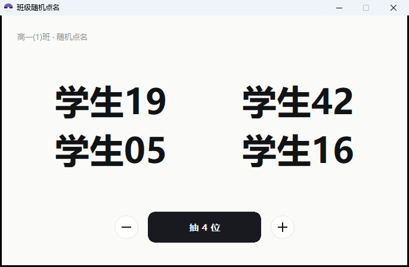

# ClassRollCall · 班级随机点名器

一个给中小学教室用的**随机点名小程序**：单文件绿色 exe，原生 Win32 + GDI，无任何运行时依赖，
在 **Windows 7 32 位**到 Windows 11 上都能直接双击运行。



## 特点

- **极简单窗口**：只有班级名、抽到的名字、`− 抽 N 位 +`
- **按权重抽**：每人可设概率（0 = 本轮最后才出现），抽取过程按权重加权
- **每次抽 1–5 人**，同一分钟内不重复，跨分钟自动开新一轮（界面上完全看不出来）
- **键盘友好**：`空格/回车` 抽、`← →` 或滚轮改人数、`Esc` 退出
- **离线可用**：启动时后台 100 ms 探测服务器，连不上就直接用本地缓存的名单，之后每 2 分钟静默重试直到连上
- **秒级同步**：一条 SSE 长连接，后台改完权重不到 1 秒客户端就生效（实测 863 ms），全程无提示
- **体积小**：约 210 KB，纯 x87 整数运算，不依赖 SSE2 / UCRT / .NET
- **静默热更新**：启动时检查版本，退出时替换自身，全程无弹窗

## 构建

需要 **MinGW-w64 i686 (msvcrt)** 工具链和 Node.js（生成名单头文件）。

```powershell
.\build.ps1              # 生成 roster.h → 编译资源 → 编译 exe
.\build.ps1 -Sign        # 额外做自签名 + 时间戳
.\packaging\package.ps1  # 打包成可分发的 release 目录（-Zip 生成压缩包）
```

产物在 `dist\ClassRollCall.exe`。

关键编译参数（为了兼容老机器）：

```
-march=pentiumpro -mfpmath=387      # 不生成 SSE，老 CPU 也能跑
-Wl,--major-subsystem-version,5 -Wl,--minor-subsystem-version,1   # 标称 Win7
-Wl,--nxcompat -Wl,--dynamicbase    # NX + ASLR
-municode -mwindows
```

## 改名单

名单在 `src\roster.txt`，一行一个人：

```
张三
李四,5        # 权重 5：被抽到的概率是权重 1 的五倍
王五,0        # 权重 0：本轮里其他人都抽完了才会出现
```

改完重新 `build.ps1` 即可（会自动生成 `src\roster.h`）。
运行时也可以通过后台同步覆盖，不用重新编译。

## 服务端（可选）

`server\` 下是一个 Python 标准库写的极简后端（无第三方依赖）：

- `POST /api/rollcall/sync` —— 客户端拉取名单与权重（带共享密钥）
- `GET  /api/rollcall/version` —— 热更新清单
- `/api/admin` —— 网页后台，调权重、加删人

`secret.json` 形如：

```json
{"token_sha256": "...", "sync_key": "...", "cookie_secret": "..."}
```

`systemd` 单元、nginx 反向代理、`gen-secret.py`（生成 secret.json）和完整部署说明都在 [`server/README.md`](server/README.md)。

## 热更新协议

`GET /api/rollcall/version` 返回纯文本：

```
ver=1.0.6
url=http://example.com/download/rollcall/ClassRollCall_v1.0.6.exe
alt=https://cdn.example.com/download/rollcall/ClassRollCall_v1.0.6.exe
sha256=<64 位十六进制>
```

客户端下载后按 `sha256` 校验，存到 `%APPDATA%\XananRollCall\pending.exe`，
**退出时**把自身复制到 `%TEMP%` 当助手，等原进程退出后替换 exe。
（助手不能直接复用被替换的那个 exe —— Windows 会锁住运行中的镜像。）

## 隐私说明

仓库里的名单是**占位数据**（`学生01`…`学生55`），演示截图同样是占位数据。
**请勿把真实学生姓名提交到公开仓库。**

## 许可证

本项目以 **[CC0 1.0 Universal](LICENSE)** 释出，即**放弃全部著作权**，进入公有领域。
你可以任意复制、修改、商用、闭源分发，**无需署名**。

> 说明：CC0 是公共领域奉献工具，严格说面向"作品"而非专为软件设计（OSI 未将其列为开源许可），
> 它不授予商标权，也不豁免他人的专利权。若你需要标准软件许可证，MIT 更常见——
> 但本项目按作者意愿采用 CC0。
